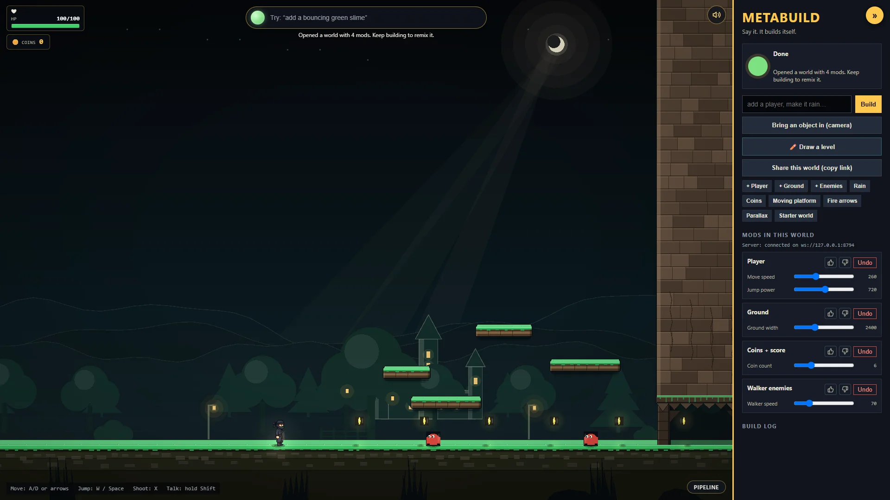
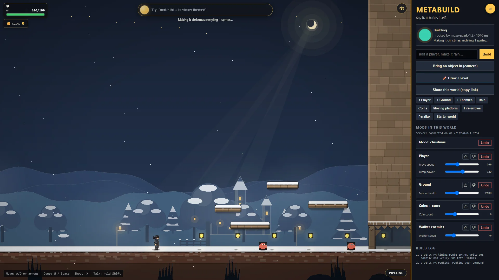
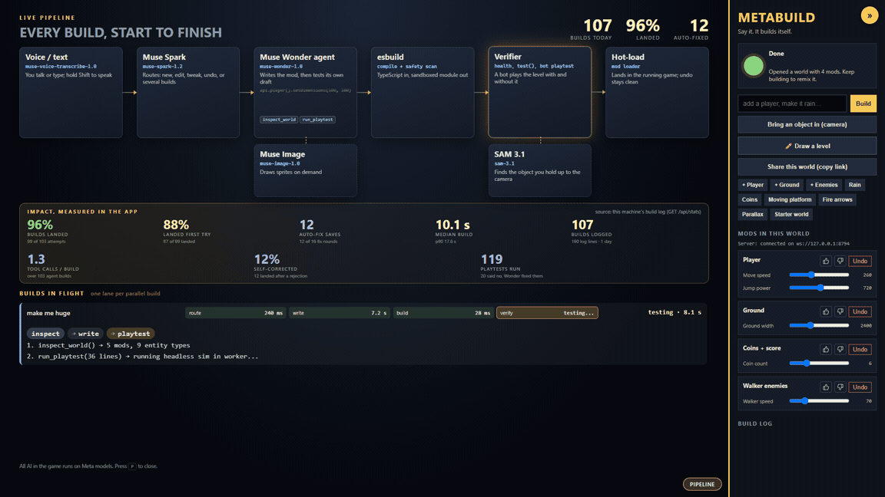
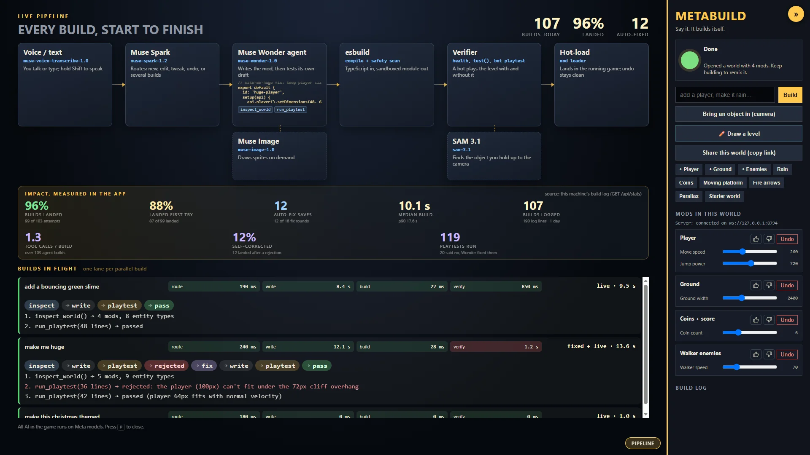
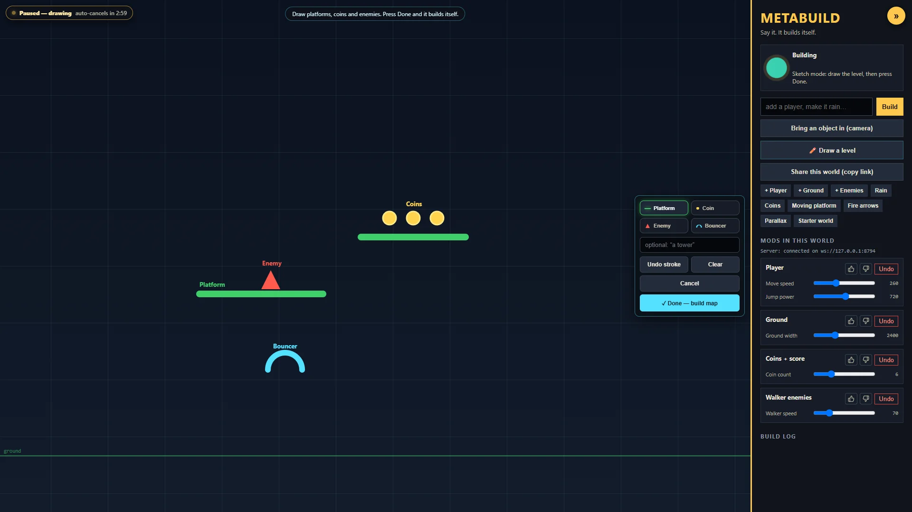
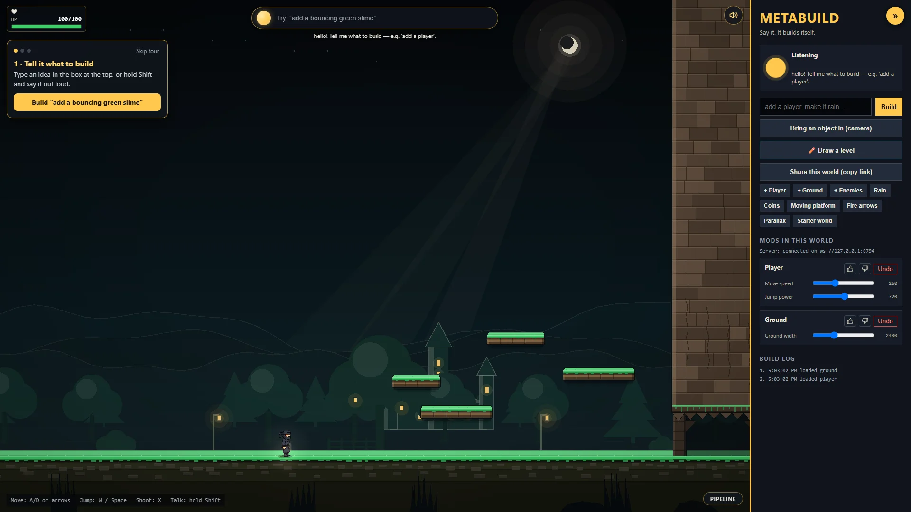

# Talk-to-Build Platformer

> Game making takes years to learn. What if it took a sentence?

You start with an empty black screen. You talk to it, and a modern pixel-art side scroller builds itself around you **while you play**:

- "add a player, make it a ninja"
- "add some ground"
- "fire arrows when I shoot"
- "turtle enemies"
- "make it spooky"

Each change is written by AI agents, **verified by a headless playtest before it goes live**, and hot-loaded into the running game without a restart.

Entry for the Meta Global AI Developer Hackathon (solo, Indie track). **Deadline: Wed Nov 4 2026, 9:00 PM ET.**

## See it in action

| Starter World (Night) | Christmas Mood Restyle |
|:---:|:---:|
|  |  |
| *Talk to build: deterministic physics platformer with live mod knobs* | *Whole-world restyle: festive palette, falling snow, frosted surfaces* |

| Agentic Playtest Auto-Fix (Live) | Pipeline Architecture & Impact Metrics |
|:---:|:---:|
|  |  |
| *The playtest bot rejects a player too big for the cliff overhang; Wonder fixes it* | *Live node graph, autonomy metrics, and parallel build lanes (press P)* |

| Draw-to-Build (Sketch Mode) | First-Run Onboarding Coach |
|:---:|:---:|
|  |  |
| *Draw platforms, coins, and enemies directly on screen* | *Interactive 3-step tour for non-coders on first load* |

## Run it in 5 minutes (judges start here)

You need **Node 22+** and a **Meta Model API key**. Get one from the [Meta Model API docs](https://dev.meta.ai/docs/models). Calls are billed to your account through the standard billing setup, and a card must be on file before calls work. Every model the game calls at runtime is a Meta model; no other AI provider is used.

```sh
git clone https://github.com/sramey/CerebralValleyMetaHackathon2026.git
cd CerebralValleyMetaHackathon2026
npm install                 # npm 11 may warn that install scripts were skipped (esbuild); the build still works
cp .env.example .env        # Windows cmd: copy .env.example .env; then set MODEL_API_KEY=<your Meta key>
npm run build && npm start  # game + AI server on one port
```

Open **http://127.0.0.1:8787/** (or your configured `PORT`) in Chrome, click the game once, and try:

| Do this | What you'll see |
|---|---|
| Type `add a bouncing green slime` in the orb bar at the top (or **hold Shift and say it**) | Spark routes it, Wonder writes a mod, the verifier playtests it, and it hot-loads in ~10–20 s while you keep playing |
| `make me huge` | The playtest bot finds you can't fit through the gap, the change is **rejected with a reason**, Wonder fixes it as a tool-using agent, and it lands. Watch the ghost window |
| `make it rain`, `add trees`, `add a dragon` | Muse Image draws art on demand; a digitize placeholder shows until it arrives. Dynamic HUD widgets appear on the top-left |
| **Bring an object in (camera)** in the side panel: type what you're holding (e.g. `coffee mug`) and hold it to the webcam (or click **Upload a photo instead**) | SAM 3.1 finds it (green box; or click the object yourself), then it's cut out, pixelated and dropped into the game as a physics prop |
| Click any creature or object | A radial menu: bigger, smaller, front, back, remove, plus 👍/👎 to teach the engine |
| **Share this world (copy link)** in the side panel | Copies a link that reopens this exact world for anyone to remix |
| Press **P** or click **PIPELINE** in the bottom-right | Live architecture pipeline view: see Spark, Wonder agent (with tools `inspect_world` / `run_playtest`), esbuild, the Verifier, and SAM 3.1 with real-time telemetry |
| `make it spooky` (or `neon`, `snowy`) | Spark art-directs a whole-world mood: the palette, fog and lighting change in ~3 s, then Muse Image redraws every AI sprite in the new style (~20–30 s). `undo` restores it |
| `make this christmas themed` | Theme words restyle the world (no new code): snow-frosted surfaces, icy hills, falling snow |
| `add some stairs` | Wonder builds code-drawn stone steps; the player walks up them |
| `give me a gun`, then press **F** | Equips a hand cannon; F (or X) fires shots that damage enemies |
| **✏️ Draw a level** (or say "let me draw a level") | Sketch ledges, coins and enemies over the game; Wonder reads the drawing and builds it |
| **⏪ Time travel** (strip under the stage) | Every build, mood and undo is a dot; hover one to see that world, Restore brings it back as a new step (nothing is ever deleted) |
| **⬇ Download game** (side panel) | Saves your world as one HTML file that plays offline in any browser, no server or AI needed |
| Click anything → **How does this work?** in the radial menu | Muse Spark explains that object's code in three plain sentences and highlights the three lines that matter |
| "build a grappling hook" | Click where you want to go (or aim with the mouse and press **B**); a rope latches onto any solid and reels you in, Jump vaults off |
| Press **P** | Pipeline view with live build numbers (landed %, first-try %, median time) |
| Click **👍** or **👎** on any mod card or radial menu | Feedback modal lets you teach the engine rules, distill skills, or auto-fix the mod live |

Move with A/D or the arrows, jump with W or Space, shoot with X, use items with F. Sound is synthesized in the browser: M mutes, [ and ] change volume, ?mute starts muted, ?noshake turns off screen shake. First visit shows a skippable 3-step coach (?coach shows it again, ?nocoach hides it); in a scripted fresh-browser run the first build landed 15.5 s after page load. Watch the top-left HUD (health, mod counters). **Fresh-clone check (2026-10-29, brand-new Chrome profile, README steps only):** local clone ~1 s, `npm install` ~7 s, `npm run build` ~5 s, page connected 0.6 s after open, first AI build verified and landed 9.8 s after typing the command.

**No key?** The game still runs: built-in mods and curated demo worlds (for example `http://127.0.0.1:8787/?w=demo-bouncy`) play without any AI calls. Developing instead? `npm run dev` (Vite on :5173) plus `npm run server` (:8787) in a second terminal, then `npm test`. Both ports come from `.env` (`VITE_PORT` / `PORT` / `VITE_WS_URL`), so a second checkout can run beside the first. Port 8787 busy? Set `PORT=8788` in `.env` and reopen on that port — the production build finds its server on the page's own origin, no rebuild needed.

## Built during the event

All code, docs and assets in this repo were created during the hackathon. Kickoff ended Mon Oct 26 2026, 12:24 PM ET; the first commit is `990a62c` (Tue Oct 27, 1:26 PM ET), and the full history is public. No pre-hackathon code is included.

- **Open-source libraries we build on** (npm, unmodified): [PixiJS](https://pixijs.com) (rendering), [ws](https://github.com/websockets/ws) (WebSocket), [esbuild](https://esbuild.github.io) (compiles AI-written mods), [Vite](https://vite.dev) (client build), [tsx](https://tsx.is), TypeScript and [Vitest](https://vitest.dev). Everything else (the engine, simulation, mod API, verifier and playtest bot, the agent loops, the art pipeline, voice proxy, camera import, share links and spend guard) is ours, written during the event.
- **Assets:** every sprite in the game is generated at runtime by Muse Image or cut from your own camera photo. There are no third-party images, fonts (system fonts only) or sound files.

## Does it work? The numbers

Every build is logged as it happens. [docs/evidence/build-stats.md](docs/evidence/build-stats.md) aggregates that log (numbers only, no prompts): about 96% of AI builds land verified and hot-loaded, most on the first try, with a median of about 10 s from request to playable. Regenerate it with `npm run stats`.

## Testing with non-coders

[docs/USER-TEST.md](docs/USER-TEST.md) is a one-page facilitator script. Open the game with `?tester=N` (an anonymous number, never a name) and run `npm run testers` afterwards: it writes aggregates only to docs/evidence/user-test.md.

## Watch the agent work

Wonder's tool loop (inspect_world, run_playtest, fix) is visible live in the pipeline (press P); autonomy numbers (tool calls per build, self-corrected %, playtests run) come from the build log via /api/stats (ADR 0033).

## Open weights (optional)

Router: Muse Spark Open (open weights) on Baseten when `BASETEN_API_KEY` is set, otherwise hosted Muse Spark; it falls back automatically, and the orb shows which model routed each command. `npm run bench:router` compares latency (ADR 0032).

## How it works

**Full picture:** [docs/ARCHITECTURE.md](docs/ARCHITECTURE.md), one diagram of the whole pipeline plus the sim, mod sandbox, ontology, learner and spend guard, each with file pointers and ADRs.


- **Engine (built-in, never generated):** 60 fps fixed-step deterministic simulation, rendering, tile collision, physics, input, camera, particles, lighting, mod loader, verifier, and the orb UI. Runs identically in the browser and headless (Node / worker) so mods can be playtested at 100x speed before they ship.
- **Everything visible is a mod.** The player, ground, enemies, art, music, and backgrounds are all mods written against a small mod API (`setup` / `dispose` / `knobs` / `test`). Mods are isolated, toggleable, and undoable.
- **Router:** Muse Spark classifies each command (tweak / new / edit / undo / question) against a world manifest. Tweaks adjust exposed knobs in under 2s; new things are written by Muse Wonder (~10-20s), compiled with esbuild, verified, then hot-loaded.
- **Art:** Muse Image generates a sprite sheet on demand per mod subject (client chroma-keys and slices it; SAM 3.1 probes/validates). Art streams asynchronously — the mod hot-loads first with a pulsing pixel-noise digitize placeholder in the entity's shape/place, then the sheet lands ([ADR 0008](docs/adr/0008-async-art-digitize-placeholder.md)). Scenery subjects (trees, rocks, sun/moon, etc.) get static variant sheets with no faces/limbs and no animation cycling; creatures keep pose sheets ([ADR 0009](docs/adr/0009-scenery-vs-creature-art.md)).
- **Voice:** hold Shift (or a gamepad shoulder) and talk. The orb pulses with mic volume, live partials from Muse Voice Transcribe show under it, and releasing submits the command. Audio is proxied through our server (the key never reaches the browser) into a pre-warmed Meta session; final text lands ~130 ms after release ([ADR 0012](docs/adr/0012-voice-hold-to-talk.md)). The text box stays as a fallback.

See [docs/DESIGN.md](docs/DESIGN.md) for all locked product and architecture decisions, [docs/SPIKE.md](docs/SPIKE.md) for the current milestone, and [docs/META-API.md](docs/META-API.md) for model endpoints and pricing.

## Current milestone: the win plan

The spike passed its go/no-go early (10/10). The remaining plan, in priority order, is in [docs/WINPLAN.md](docs/WINPLAN.md): voice (done), a deploy-ready server with share links (done), the visible verifier with a ghost playtest (done), visual kinds and effects (done), then parallel agent builds, a non-coder user test, and rehearsal. Work runs in parallel git worktrees ([docs/ORCHESTRATION.md](docs/ORCHESTRATION.md)).

## Hackathon

- **Event:** Meta Global AI Developer Hackathon (Cerebral Valley), solo entry, Indie track.
- **Deadline:** Wed Nov 4 2026, 9:00 PM ET (targeting 3 PM). Submission: 3-minute demo video, this public repo, and the product running from the setup instructions above.
- **Rubric:** Impact 30 · Meta tooling 25 · Depth 20 · Demo 25.
- **Theme:** Push the Frontier: software that rewrites itself live, with agents verifying every change before it lands.
- **Targeting:** Best Creative (Muse Image/Wonder), Best Agentic, Community vote, Most Viral on X.

## Tech at a glance

| Layer | Tech |
|---|---|
| Language | TypeScript everywhere |
| Client | Vite + PixiJS (WebGL), on-demand generated art with digitize placeholder while it loads |
| Game server | Node + `ws` WebSocket on port 8787, esbuild compiles mods, verifier steps the sim headless in-process |
| Sim core | Pure deterministic 60 Hz simulation (`src/sim`), no DOM/clock/`Math.random` — identical in browser and server verifier |
| Models (Meta Model API, `https://api.meta.ai/v1`) | **Muse Spark `muse-spark-1.2`** routes commands and picks each thing's visual kind · **Muse Wonder `muse-wonder-1.0`** writes/edits mods and fixes rejected ones as a tool-calling agent (`inspect_world`, `run_playtest`); compound commands build in parallel (`MAX_PARALLEL`, default 3) · **Muse Image `muse-image-1.0`** sprite sheets on demand · **SAM 3.1** finds objects in camera photos · **Muse Voice Transcribe** hold-to-talk, realtime. All text calls use `reasoning_effort: minimal` — see [ADR 0001](docs/adr/0001-reasoning-effort-minimal.md) |

Key decisions and why: [docs/adr/](docs/adr/README.md) · Product/architecture: [docs/DESIGN.md](docs/DESIGN.md) · Current milestone: [docs/SPIKE.md](docs/SPIKE.md) · Model notes: [docs/META-API.md](docs/META-API.md) · Build log: [progress.md](progress.md)

## Developer commands

```sh
npm run dev            # game client  -> http://127.0.0.1:5173/
npm run server         # AI server    -> ws://127.0.0.1:8787 (second terminal)
npm test               # vitest suite
npx tsx scripts/deploy-check.ts   # live share-link round trip against a running server
npx tsx scripts/spike-run.ts   # re-run the 10-command spike exam against the live server
powershell scripts/voice-synth.ps1; npx tsx scripts/voice-check.ts 10   # live voice check (synthesized speech)
```

**Production (one port):** `npm run build && npm start` serves the game and its WebSocket on one port (`PORT`, default 8787; `HOST=0.0.0.0` to expose). **Share this world** copies a `/?w=<id>` link that reopens the exact world for anyone to remix. Per-visitor and global spend caps plus curated demo worlds keep a public URL playable without burning Meta credit; `AI_KILL_SWITCH=1` turns all AI off. A `Dockerfile` is included (`docker run -p 8787:8787 -e MODEL_API_KEY=... -v metabuild-data:/app/data metabuild`). Env vars are listed in `.env.example`; details in [ADR 0014](docs/adr/0014-deploy-share-spend-visitor.md).

Never commit keys. `.env` is gitignored.

## Status (2026-10-29)

**Working and verified**

- Engine, mod API + loader (knobs, undo, clean dispose), sample mods (player, ground, enemies, rain, coins, moving platform, fire arrows).
- Live AI path end-to-end: type a sentence → Spark routes → Wonder writes a mod → esbuild compiles → 600-frame headless verify (failed mods are rejected, game unchanged, one auto-fix round) → hot-loads into the running game with its own mod card and knobs.
- **Spike exam: 10/10 commands in one world, median 8.7s per build (bar: 8/10, <15s)** — run it yourself with `scripts/spike-run.ts`. This passes the Thu Oct 29 go/no-go bar early.
- **Real usage log:** 78 AI builds through 2026-10-28 → 74 landed (95%), median 9.4 s, p90 26.5 s, 9 rescued by the auto-fix (`logs/builds.jsonl`, `scripts/review-log.ts`).
- **Voice:** hold Shift and talk. 10/10 live runs transcribed correctly in the worktree check, 4/4 on main; release → final text p50 ~126 ms ([ADR 0012](docs/adr/0012-voice-hold-to-talk.md)).
- **Camera import:** hold up a real object; SAM 3.1 finds it (~1.2 s), it's cut out, pixelated and dropped into the game as a physics prop ([ADR 0010](docs/adr/0010-camera-object-prototype.md)).
- **Combat and health:** opt-in hostiles and heroes, 100 HP, health bars, player respawn ([ADR 0011](docs/adr/0011-combat-targeting-and-health.md)). Clickable objects with a radial menu.
- **"It can't break":** every AI-written mod is playtested by a scripted bot in a copy of *your* world (3 seeds × 2 worlds, 1–6 ms). A ghost window replays the actual run. A failing change is rejected with a one-line reason, and Wonder, as a tool-using agent (`run_playtest`), fixes and re-playtests it before it lands. Live on main: "make me huge" → *"You'd be too big to fit through the gap"* → fixed → landed, 2/2 (7/7 across the lease's runs once tuned) ([ADR 0013](docs/adr/0013-visible-verifier.md)).
- **Visual kinds and effects:** Spark's router also decides what kind of thing you asked for (shape, effect, prop or creature) in the same call. Shapes (ball, ring, spikes, star…) and effects are drawn in code with no image wait; only props and creatures go to Muse Image. Rain has slanted streaks, splashes and mist, fog drifts as soft puffs, and explosions have a flash, fire, sparks, smoke and a shockwave (~0.1 ms/frame) ([ADR 0015](docs/adr/0015-spark-visual-kind-shapes-fx.md)).
- **Share links, spend guard, visitor mode:** a live check builds 3 AI mods, saves the world, reopens the link in a fresh session with byte-identical code, and remixes it (`scripts/deploy-check.ts`, 8/8 on main).
- Tests: 441 passing (`npm test`, green in a fresh clone), typecheck clean, production build green.

**Art pipeline: first proof (2026-10-27)**

- Muse Image (`muse-image-1.0`) generates a sprite sheet in ~8s; the client chroma-keys the magenta background, slices frames, and animates the player as a real AI-drawn ninja (idle/run/jump). Regenerate with `npx tsx scripts/art-sheet.ts`. SAM 3.1 answers in ~1.2s with box + encoded mask (mask decode pending — [ADR 0007](docs/adr/0007-art-pipeline-chroma-key-first.md)). Art is now generated on demand per mod subject and streams asynchronously with a digitize placeholder while it loads ([ADR 0008](docs/adr/0008-async-art-digitize-placeholder.md)); scenery subjects render as static variants with no animation cycling ([ADR 0009](docs/adr/0009-scenery-vs-creature-art.md)).

**Not built yet**
- Goal-reachability search (the playtest bot runs right and jumps; it doesn't prove a goal is reachable).
- Endless level generator (cut for the hackathon).
- Public hosting (deploy-ready; host not chosen yet), worker-thread verifier isolation ([ADR 0003](docs/adr/0003-verifier-in-process-empty-world.md)).
- Known nit: relative tweaks ("jump higher") sometimes build a new mod instead of instantly tweaking a knob ([ADR 0005](docs/adr/0005-tweak-edit-fallbacks.md)).
