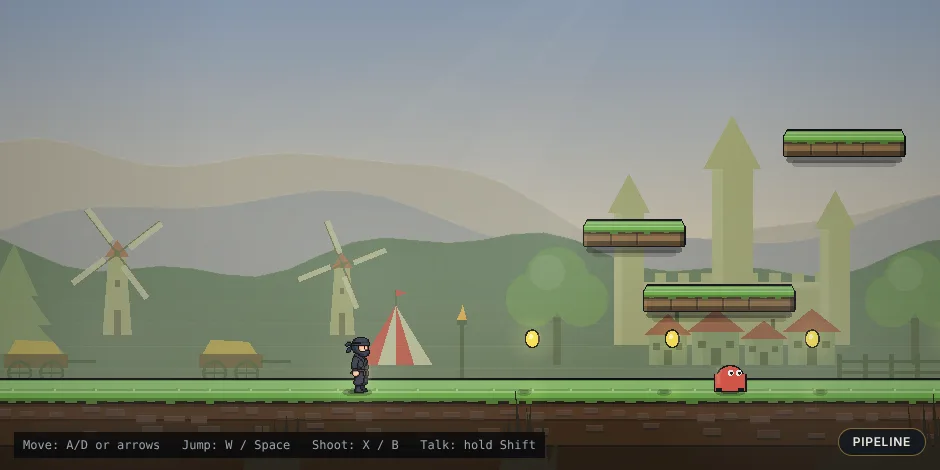
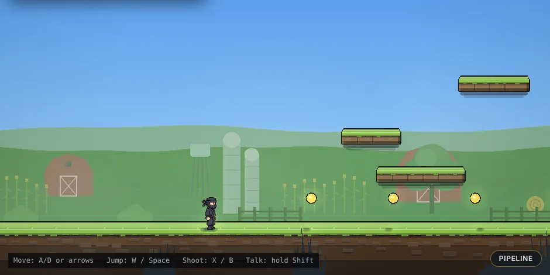

# Talk-to-Build: prompt to verified, playable software, live

> One sentence becomes logic, a test, art and a playable asset, and an agent proves it works before it goes live.

This is a technology demonstration, not just a game. The engine underneath turns spoken or typed words into running code with its own test, playtests that code in a copy of your world, fixes it when the playtest says no, draws its art, and hot-loads it without a restart. A pixel-art platformer is the testbed because you can *see* every change land.

You start with an empty black screen. You talk to it, and a side scroller builds itself around you **while you play**:

- "add a player, make it a ninja"
- "add some ground"
- "fire arrows when I shoot"
- "turtle enemies"
- "make it spooky"

Each change is written by AI agents, **verified by a headless playtest before it goes live**, and hot-loaded into the running game without a restart.

Entry for the Meta Global AI Developer Hackathon (solo, Indie track). **Deadline: Wed Nov 4 2026, 9:00 PM ET.**

**Demo video (3:00):** _link added at submission_ · **Run it yourself:** [5-minute quickstart](#run-it-in-5-minutes-judges-start-here) · **Evidence:** [build stats](docs/evidence/build-stats.md)

**Video presentation:** [docs/talk/index.html](docs/talk/index.html) is the scroll-driven deck the demo video talks over. Open it in any browser, offline; Space steps forward, arrow keys step back and forth, H hides the chrome.

## For judges: the 60-second version

| Rubric | What to look at | Evidence |
|---|---|---|
| **Impact (30)** | Anyone makes a playable game by talking, with no code and no game-engine knowledge. A sentence becomes a working, playable change in about 11 s. | [93% of AI builds land verified (162 of 175), median 11.2 s](docs/evidence/build-stats.md) · first-run coach for non-coders · share links and one-file offline export |
| **Meta tooling (25)** | Five Meta models do real jobs at runtime, plus Wonder's agent features. No other AI provider is used anywhere in the product. | [Who does what](#meta-models-who-does-what) below |
| **Depth (20)** | A pure, deterministic 60 Hz engine runs the same in the browser and headless. Every AI-written mod is compiled, then playtested by a bot in a copy of *your* world before it may load. Failures are rejected with a reason and auto-fixed by a tool-using agent. | [ARCHITECTURE.md](docs/ARCHITECTURE.md) · [73 ADRs](docs/adr/README.md) · 1100+ tests · `npm run cold:check` |
| **Demo (25)** | Voice in, game out, live. The "make me huge" beat shows the verifier reject a change and Wonder fix it on camera, then **How was this made?** replays the whole chain for that object. | [Shot list](docs/DEMO.md) · [rejected → fixed GIF](docs/img/make-me-huge-rejected-fixed.gif) |

**What's new here:** most "AI makes a game" demos generate a game once. Here the software **rewrites itself while you use it**, and **no change goes live until an agent has proved you can still play**. Click anything and choose **How was this made?** to see the whole chain for that one object: your words, Spark's route, Wonder's code and the test it wrote, the rejected draft and the fix, every check the verifier ran, the Muse Image prompt and sheet, and the timings ([ADR 0065](docs/adr/0065-how-was-this-made-receipt.md)).

### Meta models: who does what

| Meta model / feature | Its job in the game | When it runs |
|---|---|---|
| **Muse Spark** (`muse-spark-1.2`) | Routes every command (tweak / new / edit / undo / mood / question), picks each thing's visual kind, splits compound asks, art-directs moods, explains code, kid-safe screen | Every command, in about 1 s |
| **Muse Wonder** (`muse-wonder-1.0`) | Writes and edits mods. As a **tool-calling agent** (`inspect_world`, `run_playtest`) it fixes mods the verifier rejected. Compound asks run as parallel sub-builds | Every new thing, about 10 to 20 s |
| **Muse Image** (`muse-image-1.0`) | Draws sprite sheets on demand and redraws the world in a new mood (edit from an anchor) | Each new creature or prop, async |
| **SAM 3.1** | Finds the object you hold up to the webcam so it can be cut out and dropped into the game | Camera import, about 1.2 s |
| **Muse Voice Transcribe** | Hold Shift and talk. Live partials appear under the orb | Voice, about 130 ms after release |
| **Muse Spark Open** (open weights, via Baseten) | Optional router, plus a background reviewer that checks every finished build, swaps in a fix only if it passes the same verify gates, and learns a rule from it (ADR 0068). Without the key both are simply off and hosted Spark routes as before | When `BASETEN_API_KEY` is set (optional) |

## See it in action

| Starter World (Night) | Christmas Mood Restyle |
|:---:|:---:|
|  |  |
| *Talk to build: deterministic physics platformer with live mod knobs* | *Whole-world restyle: festive palette, falling snow, frosted surfaces* |

| "Change the background to medieval" | "Change the background to be in an Indiana farm" |
|:---:|:---:|
|  |  |
| *Castle, village, windmills, tents and torches across three parallax bands* | *Flat farmland: barns, silos, a water tower, corn rows and hay bales* |

| Agentic Playtest Auto-Fix (Live) | Pipeline Architecture & Impact Metrics |
|:---:|:---:|
|  |  |
| *The playtest bot rejects a player too big for the cliff overhang; Wonder fixes it* | *Live node graph, autonomy metrics, and parallel build lanes (press P)* |

| Draw-to-Build (Sketch Mode) | First-Run Onboarding Coach |
|:---:|:---:|
|  |  |
| *Draw platforms, coins, and enemies directly on screen* | *Interactive 3-step tour for non-coders on first load* |

## Run it in 5 minutes (judges start here)

You need **Node 22+**. To let the AI build things you also need a **Meta Model API key**, from the [Meta Model API docs](https://dev.meta.ai/docs/models); without one the game still runs (built-in mods and demo worlds, no AI calls, see **No key?** below). Calls are billed to your account through the standard billing setup, and a card must be on file before calls work. Every model the game calls at runtime is a Meta model; no other AI provider is used. `BASETEN_API_KEY` (open-weights router and reviewer, see **Open weights** below) is optional.

```sh
git clone https://github.com/sramey/CerebralValleyMetaHackathon2026.git
cd CerebralValleyMetaHackathon2026
npm install                 # npm 11 may warn that install scripts were skipped (esbuild); the build still works
cp .env.example .env        # Windows cmd: copy .env.example .env; then put your Meta key after MODEL_API_KEY= (left empty it runs keyless, see No key? below)
npm run build && npm start  # game + AI server on one port; the log prints `Meta key: found` and the URL to open
```

Open **http://127.0.0.1:8787/** (or your configured `PORT`) in Chrome, click the game once, and try:

| Do this | What you'll see |
|---|---|
| Type `add a bouncing green slime` in the orb bar at the top (or **hold Shift and say it**) | Spark routes it, Wonder writes a mod, the verifier playtests it, and it hot-loads in ~10–20 s while you keep playing; its sprite art is drawn after that (about 15–30 s, shown as a pixel-noise placeholder until it lands) |
| `make me huge` | The playtest bot finds you can't fit through the gap, the change is **rejected with a reason**, Wonder fixes it as a tool-using agent, and it lands. Watch the ghost window |
| `make it rain`, `add trees`, `add a dragon` | Muse Image draws art on demand; a digitize placeholder shows until it arrives. Dynamic HUD widgets appear on the top-left |
| **📷 Bring an object in** (top-right of the game): type what you're holding (e.g. `coffee mug`) and hold it to the webcam (or click **Upload a photo instead**) | SAM 3.1 finds it (green box; or click the object yourself), then it's cut out, pixelated and dropped into the game as a physics prop |
| Click any creature or object | A radial menu: bigger, smaller, front, back, remove, plus 👍/👎 to teach the engine |
| **Share this world (copy link)** in the side panel (open it with « at the top right) | Copies a link that reopens this exact world for anyone to remix |
| Just reload, or restart the server | Your world saves itself (one autosave per browser, scrubbed of keys and personal paths) and comes back as you left it; **New world** in the side panel starts a blank one ([ADR 0070](docs/adr/0070-world-survives-reload.md)) |
| Press **P** or click **PIPELINE** in the bottom-right | Live architecture pipeline view: see Spark, Wonder agent (with tools `inspect_world` / `run_playtest`), esbuild, the Verifier, and SAM 3.1 with real-time telemetry, plus live build numbers (landed %, first-try %, median time) |
| `make it spooky` (or `neon`, `snowy`) | Spark art-directs a whole-world mood: the palette, fog and lighting change in ~3 s, then Muse Image redraws every AI sprite in the new style (~20–30 s). `undo` restores it |
| `make this christmas themed` | Theme words restyle the world (no new code): snow-frosted surfaces, icy hills, falling snow |
| `change the background to medieval` (or `…to be in an Indiana farm`, `desert`, `city`) | A new themed parallax backdrop in under a second, with no router call: a castle on the hill, village, church, windmills, tents and torches (or barns, silos, corn and hay bales on flat farmland). Sprites keep their look. Other places ("ancient Egypt", "a jungle") get palette and scenery from one Spark call. `spooky castle` puts the spooky palette on the medieval scenery. `undo` restores it ([ADR 0067](docs/adr/0067-themed-parallax-backdrops.md)) |
| `turn this into a 2d space shooter` | Genre change in one sentence: the terrain and scenery disappear, a space sky replaces the world, the ninja becomes a generated ship, and there are targets to shoot. `undo` brings the platformer back exactly ([ADR 0066](docs/adr/0066-genre-change-set-scene.md)) |
| `build a volcano` | A real drawn prop, not a flat shape: named things get Muse Image art and are sliced pose by pose ([item quality review](docs/process/item-quality-review.md)). Big set-pieces sit on the ground behind the play layer, and lava, rocks and sparks are glowing shaded particles |
| `add some stairs` | Wonder builds code-drawn stone steps; the player walks up them |
| `give me a gun`, then press **F** | Equips a hand cannon; F (or X) fires shots that damage enemies |
| **✏️ Draw a level** (top-right of the game, or say "let me draw a level") | Sketch ledges, coins and enemies over the game; Wonder reads the drawing and builds it. Drawn enemies patrol, chase, take bullets and die to a stomp |
| **⏪ Time travel** (strip under the stage) | Every build, mood and undo is a dot; hover one to see that world, Restore brings it back as a new step (nothing is ever deleted) |
| **⬇ Download game** (side panel) | Saves your world as one HTML file that plays offline in any browser, no server or AI needed |
| Click anything → **How was this made?** (gold receipt icon) in the radial menu | The receipt for that object: your words, how Spark routed them, Wonder's code and its own test, the draft the playtest rejected and the fix, each verifier check ticking green, the Muse Image sheet beside its cut-out, and a time bar. No model call |
| Click anything → **How does this work?** in the radial menu | Muse Spark explains that object's code in three plain sentences and highlights the three lines that matter |
| "build a grappling hook" | Click where you want to go (or aim with the mouse and press **B**); a rope latches onto any solid and reels you in, Jump vaults off |
| Changed your mind mid-build? | Click the **×** on the build's chip under the orb; just that build stops and nothing lands ([ADR 0060](docs/adr/0060-cancel-a-running-build.md)) |
| Click **👍** or **👎** on any mod card or radial menu | Feedback modal lets you teach the engine rules, distill skills, or auto-fix the mod live |

Move: A/D or arrows, Jump: W or Space, Shoot: X or B (also J/F), Items: Q switch, G drop, R reload (or 1–9, mouse wheel), use items with F or E. Talk: hold Shift. Sound is synthesized in the browser: M mutes, [ and ] change volume, ?mute starts muted, ?noshake turns off screen shake. First visit shows a skippable 3-step coach (?coach shows it again, ?nocoach hides it); in a scripted fresh-browser run the first build landed 15.5 s after page load. Watch the top-left HUD (health, mod counters). **Fresh-clone check (2026-10-30, a clean clone of `main`, README steps only, Windows, Node 24, npm 11):** clone 1.8 s, `npm install` 7.9 s, `npm run build` 6.1 s, server listening 1.3 s after `npm start`; "add a bouncing green slime" was verified and live 7.2 s after typing (Spark 1.0 s, Wonder 6.2 s), and its AI-drawn sprite replaced the placeholder 27 s after that. With no key the same page loads, the orb says up front that the AI is off (grey, "AI off"), the tour does not start, and a startup screen says which features need a Meta key (voice, building, routing, art) and what still plays (physics, combat, the demo worlds, drawing a level, offline export), then drops you into the demo worlds ([ADR 0079](docs/adr/0079-startup-no-key-screen.md)).

**No key?** The game still runs, with no AI calls: built-in mods, the four curated demo worlds, ✏️ **Draw a level** (your boxes become the level directly), the 🧠 panel, Share and Download game. Open a demo world from the « panel or by URL: `?w=demo-starter`, `?w=demo-bouncy`, `?w=demo-arrows`, `?w=demo-rainy` (for example `http://127.0.0.1:8787/?w=demo-bouncy`). What you see keyless: the server log says `Meta key: not set, AI is off`, the orb is grey and says the AI is off (no "tell me what to build" invitation), the first-run tour is skipped, and typing a build shows "The AI isn't connected on this server". `cp .env.example .env` without editing it gives exactly this, because `MODEL_API_KEY=` ships empty. Developing instead? `npm run dev` (Vite on :5173) plus `npm run server` (:8787) in a second terminal, then `npm test`. Both ports come from `.env` (`VITE_PORT` / `PORT` / `VITE_WS_URL`), so a second checkout can run beside the first. Port 8787 busy? Set `PORT=8788` in `.env` and reopen on that port — the production build finds its server on the page's own origin, no rebuild needed. `npm run cold:check` (proves the page and WebSocket handshake with zero AI calls) starts its own server, so it needs a free port: stop `npm start` first, or pass `--port <n>`.

**Did it start right?** The server log should say `Meta key: found` and print the URL to open. `Meta key: not set` means AI is off: check `.env` sits in the repo root with `MODEL_API_KEY=<key>` (no quotes needed), then restart. A Meta API error in the orb usually means the key has no card on file yet.

### Known limitations

- **Local, single-user, your own key.** The game is meant to run on your machine with your own Meta key. It is not hardened for hosting strangers' prompts on a shared key.
- **The mod sandbox is not a security boundary.** AI-written mods pass a forbidden-token check and are verified in the server process, so a determined mod could reach Node globals (and the server's environment, including your key) by indirection. A public host would need the verifier moved into a worker thread with no environment and a timeout ([ADR 0003](docs/adr/0003-verifier-in-process-empty-world.md)).
- **AI calls cost money.** Each build is a few Meta calls billed to your key. The spend guard caps builds, images, camera and voice per day (`BUDGET_*` in `.env.example`), and `AI_KILL_SWITCH=1` turns every AI call off.
- **Chrome is the tested browser.** Voice and camera need mic and webcam permission; typing works everywhere.

## Built during the event

All code, docs and assets in this repo were created during the hackathon. Kickoff ended Mon Oct 26 2026, 12:24 PM ET; the first commit is `990a62c` (Tue Oct 27, 1:26 PM ET), and the full history is public. No pre-hackathon code is included.

- **Open-source libraries we build on** (npm, unmodified): [PixiJS](https://pixijs.com) (rendering), [ws](https://github.com/websockets/ws) (WebSocket), [esbuild](https://esbuild.github.io) (compiles AI-written mods), [Vite](https://vite.dev) (client build), [tsx](https://github.com/privatenumber/tsx), TypeScript and [Vitest](https://vitest.dev). Everything else (the engine, simulation, mod API, verifier and playtest bot, the agent loops, the art pipeline, voice proxy, camera import, share links and spend guard) is ours, written during the event.
- **Assets:** every sprite in the game is generated at runtime by Muse Image or cut from your own camera photo. There are no third-party images, fonts (system fonts only) or sound files.

## Does it work? The numbers

Every build is logged as it happens. [docs/evidence/build-stats.md](docs/evidence/build-stats.md) aggregates that log (numbers only, no prompts): about 93% of AI builds land verified and hot-loaded (162 of 175 requests, 146 on the first try), with a median of 11.2 s from request to playable. Regenerate it with `npm run stats`.

## Testing with non-coders

[docs/USER-TEST.md](docs/USER-TEST.md) is a one-page facilitator script. Open the game with `?tester=N` (an anonymous number, never a name) and run `npm run testers` afterwards: it writes aggregates only to docs/evidence/user-test.md.

## Watch the agent work

Wonder's tool loop (inspect_world, run_playtest, fix) is visible live in the pipeline (press P); autonomy numbers (tool calls per build, self-corrected %, playtests run) come from the build log via /api/stats (ADR 0033).

## Open weights (optional)

With `BASETEN_API_KEY` set, Muse Spark Open (open weights, served on Baseten) does two jobs. **Router:** it routes commands instead of hosted Muse Spark, falls back automatically, and the orb shows which model routed each one; `npm run bench:router` compares latency ([ADR 0032](docs/adr/0032-open-weights-router-on-baseten.md)). **Reviewer:** after a build lands, it reviews the code in the background and swaps in a fix only if the fix passes the same compile, 600-frame verify and playtest gates, then learns a rule from it; the object's **How was this made?** receipt shows the review ([ADR 0068](docs/adr/0068-open-weights-build-reviewer.md); `REVIEWER=off` disables it). Without the key both are off and nothing else changes.

## How it works

**Full picture:** [docs/ARCHITECTURE.md](docs/ARCHITECTURE.md), one diagram of the whole pipeline plus the sim, mod sandbox, ontology, learner and spend guard, each with file pointers and ADRs.


- **Engine (built-in, never generated):** 60 fps fixed-step deterministic simulation, rendering, tile collision, physics, input, camera, particles, lighting, mod loader, verifier, and the orb UI. Runs identically in the browser and headless (Node / worker) so mods can be playtested at 100x speed before they ship.
- **Everything visible is a mod.** The player, ground, enemies, art, music, and backgrounds are all mods written against a small mod API (`setup` / `dispose` / `knobs` / `test`). Mods are isolated, toggleable, and undoable.
- **Router:** Muse Spark classifies each command (tweak / new / edit / undo / mood / question / order) against a world manifest, then a named pipeline of deterministic route rules (`server/route-rules.ts`) checks its answer. Tweaks adjust exposed knobs in under 2s; orders to creatures already in the world ("chickens, follow me") skip the model entirely; new things are written by Muse Wonder (~10-20s), compiled with esbuild, verified, then hot-loaded.
- **Things you build answer back:** mods react to events (touch, hit, death, interact, order, signal) instead of polling, characters talk in speech bubbles, anything marked interactable shows a `B · Talk` prompt, and any creature obeys follow / come / stay / go away / carry on by voice with no rebuild ([ADR 0059](docs/adr/0059-living-creations-events-speech-orders-and-route-rules.md)).
- **Art:** Muse Image generates a sprite sheet on demand per mod subject (client chroma-keys and slices it; SAM 3.1 probes/validates). Art streams asynchronously — the mod hot-loads first with a pulsing pixel-noise digitize placeholder in the entity's shape/place, then the sheet lands ([ADR 0008](docs/adr/0008-async-art-digitize-placeholder.md)). Scenery subjects (trees, rocks, sun/moon, etc.) get static variant sheets with no faces/limbs and no animation cycling; creatures keep pose sheets ([ADR 0009](docs/adr/0009-scenery-vs-creature-art.md)).
- **Voice:** hold Shift (or a gamepad shoulder) and talk. The orb pulses with mic volume, live partials from Muse Voice Transcribe show under it, and releasing submits the command. Audio is proxied through our server (the key never reaches the browser) into a pre-warmed Meta session; final text lands ~130 ms after release ([ADR 0012](docs/adr/0012-voice-hold-to-talk.md)). The text box stays as a fallback.

See [docs/DESIGN.md](docs/DESIGN.md) for all locked product and architecture decisions, [docs/SPIKE.md](docs/SPIKE.md) for the current milestone, and [docs/META-API.md](docs/META-API.md) for model endpoints and pricing.

## Current milestone: the win plan

The spike passed its go/no-go early (10/10). The remaining plan, in priority order, is in [docs/WINPLAN.md](docs/WINPLAN.md): voice (done), a deploy-ready server with share links (done), the visible verifier with a ghost playtest (done), visual kinds and effects (done), parallel agent builds (done), then a non-coder user test and rehearsal. Work runs in parallel git worktrees ([docs/process/ORCHESTRATION.md](docs/process/ORCHESTRATION.md)).

## Hackathon

- **Event:** Meta Global AI Developer Hackathon (Cerebral Valley), solo entry, Indie track.
- **Deadline:** Wed Nov 4 2026, 9:00 PM ET (targeting 3 PM). Submission: 3-minute demo video, this public repo, and the product running from the setup instructions above.
- **Rubric:** Impact 30 · Meta tooling 25 · Depth 20 · Demo 25.
- **Theme:** Push the Frontier: software that rewrites itself live, with agents verifying every change before it lands.
- **Targeting:** Best Creative (Muse Image/Wonder), Best Agentic, Community vote, Most Viral on X.

## Tech at a glance

| Layer | Tech |
|---|---|
| Language | TypeScript everywhere |
| Client | Vite + PixiJS (WebGL), on-demand generated art with digitize placeholder while it loads |
| Game server | Node + `ws` WebSocket on port 8787, esbuild compiles mods, verifier steps the sim headless in-process |
| Sim core | Pure deterministic 60 Hz simulation (`src/sim`), no DOM/clock/`Math.random` — identical in browser and server verifier |
| Models (Meta Model API, `https://api.meta.ai/v1`) | **Muse Spark `muse-spark-1.2`** routes commands and picks each thing's visual kind · **Muse Wonder `muse-wonder-1.0`** writes/edits mods and fixes rejected ones as a tool-calling agent (`inspect_world`, `run_playtest`); compound commands build in parallel (`MAX_PARALLEL`, default 4) · **Muse Image `muse-image-1.0`** sprite sheets on demand · **SAM 3.1** finds objects in camera photos · **Muse Voice Transcribe** hold-to-talk, realtime. All text calls use `reasoning_effort: minimal` — see [ADR 0001](docs/adr/0001-reasoning-effort-minimal.md) |

Key decisions and why: [docs/adr/](docs/adr/README.md) · Product/architecture: [docs/DESIGN.md](docs/DESIGN.md) · Current milestone: [docs/SPIKE.md](docs/SPIKE.md) · Model notes: [docs/META-API.md](docs/META-API.md) · Build log: [progress.md](progress.md)

## Developer commands

```sh
npm run dev            # game client  -> http://127.0.0.1:5173/
npm run server         # AI server    -> ws://127.0.0.1:8787 (second terminal)
npm test               # vitest suite
npx tsx scripts/deploy-check.ts   # live share-link round trip against a running server
npx tsx scripts/spike-run.ts   # re-run the 10-command spike exam against the live server
powershell scripts/voice-synth.ps1; npx tsx scripts/voice-check.ts 10   # live voice check (synthesized speech)
```

**Production (one port):** `npm run build && npm start` serves the game and its WebSocket on one port (`PORT`, default 8787; `HOST=0.0.0.0` to expose). **Share this world** copies a `/?w=<id>` link that reopens the exact world for anyone to remix. Per-visitor and global spend caps plus curated demo worlds keep a public URL playable without burning Meta credit; `AI_KILL_SWITCH=1` turns all AI off. A `Dockerfile` is included (`docker run -p 8787:8787 -e MODEL_API_KEY=... -v metabuild-data:/app/data metabuild`). Env vars are listed in `.env.example`; details in [ADR 0014](docs/adr/0014-deploy-share-spend-visitor.md).

Never commit keys. `.env` is gitignored.

## License

[MIT](LICENSE). How the work was organized during the event (orchestrator and AI worker sessions in git worktrees) is recorded in [docs/process/](docs/process/README.md).

## Status (2026-10-31)

**Working and verified**

- Engine, mod API + loader (knobs, undo, clean dispose), sample mods (player, ground, enemies, rain, coins, moving platform, fire arrows).
- Live AI path end-to-end: type a sentence → Spark routes → Wonder writes a mod → esbuild compiles → 600-frame headless verify (failed mods are rejected, game unchanged, one auto-fix round) → hot-loads into the running game with its own mod card and knobs.
- **Spike exam: 10/10 commands in one world, median 8.7s per build (bar: 8/10, <15s)** — run it yourself with `scripts/spike-run.ts`. This passes the Thu Oct 29 go/no-go bar early.
- **Real usage log:** 175 AI builds through 2026-10-30 → 162 landed (92.6%), median 11.2 s, p90 26.9 s ([docs/evidence/build-stats.md](docs/evidence/build-stats.md), regenerated with `npm run stats`).
- **Voice:** hold Shift and talk. 10/10 live runs transcribed correctly in the worktree check, 4/4 on main; release → final text p50 ~126 ms ([ADR 0012](docs/adr/0012-voice-hold-to-talk.md)).
- **Camera import:** hold up a real object; SAM 3.1 finds it (~1.2 s), it's cut out, pixelated and dropped into the game as a physics prop ([ADR 0010](docs/adr/0010-camera-object-prototype.md)).
- **Combat and health:** opt-in hostiles and heroes, 100 HP, health bars, player respawn ([ADR 0011](docs/adr/0011-combat-targeting-and-health.md)). Clickable objects with a radial menu.
- **"It can't break":** every AI-written mod is playtested by a scripted bot in a copy of *your* world (3 seeds × 2 worlds, 1–6 ms). A ghost window replays the actual run. A failing change is rejected with a one-line reason, and Wonder, as a tool-using agent (`run_playtest`), fixes and re-playtests it before it lands. Live on main: "make me huge" → *"You'd be too big to fit through the gap"* → fixed → landed, 2/2 (7/7 across the lease's runs once tuned) ([ADR 0013](docs/adr/0013-visible-verifier.md)).
- **Visual kinds and effects:** Spark's router also decides what kind of thing you asked for (shape, effect, prop or creature) in the same call. Shapes (ball, ring, spikes, star…) and effects are drawn in code with no image wait; only props and creatures go to Muse Image. Rain has slanted streaks, splashes and mist, fog drifts as soft puffs, and explosions have a flash, fire, sparks, smoke and a shockwave (~0.1 ms/frame) ([ADR 0015](docs/adr/0015-spark-visual-kind-shapes-fx.md)).
- **Share links, spend guard, visitor mode:** a live check builds 3 AI mods, saves the world, reopens the link in a fresh session with byte-identical code, and remixes it (`scripts/deploy-check.ts`, 8/8 on main).
- **Crash containment:** a mod that throws mid-game is taken out and the orb says so; the rest of the world keeps running. Every loop in an AI-written mod gets an iteration guard at compile time, so an infinite loop fails verification in milliseconds instead of hanging the server or the tab ([ADR 0056](docs/adr/0056-contain-crashing-and-looping-mods.md)).
- **Engine budget:** a 500-entity level steps in ~0.4 ms (2 ms budget) with a grid broad phase that gives identical results to a full scan ([ADR 0057](docs/adr/0057-engine-rules-gear-shots-ground-broad-phase.md)).
- **Voice orders and living creations:** "chickens, follow me", "everyone stay", "dragon, go away" route locally in 1–4 ms with no model call (works with no key) and the engine steers the creatures; mods get events, speech bubbles and an action-key interaction ([ADR 0059](docs/adr/0059-living-creations-events-speech-orders-and-route-rules.md), `tests/interact.test.ts`, `tests/route-rules.test.ts`).
- **Genre change:** "turn this into a space shooter" hides the platformer terrain and scenery, paints a space sky, re-skins the player as a generated ship and builds shootable targets on the shared combat path; one undo restores everything ([ADR 0066](docs/adr/0066-genre-change-set-scene.md), `tests/scene.test.ts`, `tests/genre-change.test.ts`).
- **"How was this made?":** every AI-built object carries a receipt of its whole chain, from words to verified, playable mod, opened from the radial menu with no model call ([ADR 0065](docs/adr/0065-how-was-this-made-receipt.md), `tests/receipt.test.ts`). Sketch, paper and photo builds show their code and test but no build record yet.
- **Themed backdrops, item quality, UI:** "change the background to medieval" repaints the sky and scenery with no model call ([ADR 0067](docs/adr/0067-themed-parallax-backdrops.md)); named props get real art with pose-bound sheet slicing, not flat shapes; the health bar draws above every sprite and follows size changes; undoing a mood restores the world cleanly.
- **Rehearsed:** the eight demo commands ran 20 times each against the live server, with pass rates and timings in [docs/process/rehearsal-20x.md](docs/process/rehearsal-20x.md).
- **Open-weights reviewer:** Muse Spark Open reviews finished builds in the background and swaps in verified fixes ([ADR 0068](docs/adr/0068-open-weights-build-reviewer.md)).
- **Second opinion on stage:** when Muse Spark Open (open weights) catches a bug in a finished build, a green card names the bug with "Fixed · re-verified · live", the fixed object flashes and the 🧠 button shows "+1 rule". Say **"double-check my world"** to make it review every build on demand ([ADR 0078](docs/adr/0078-open-weights-second-opinion-on-stage.md); needs `BASETEN_API_KEY`; `REVIEWER=off` disables it).
- **What it has learned:** the gold **🧠 What it has learned** button at the top right of the game opens a live scorecard of the reviewer, each fix with its code diff and the rule it taught, plus the rules and skills library; works without the open-weights key ([ADR 0069](docs/adr/0069-what-it-has-learned-area.md)).
- **Playtest fixes (2026-10-30):** after a first-time player's session, drawn enemies now patrol, chase, take bullets and die to a stomp; pets never hurt the player ([ADR 0071](docs/adr/0071-hostile-identity-stomp-pets-and-facing.md)); creature sheets slice into 4 whole frames at one scale, wave walkers stay on the ground, and "make it shoot fire" keeps the creature's art ([ADR 0072](docs/adr/0072-walker-hostiles-grounding-and-art-persistence.md)); a drawn crosshair shows where you aim ([ADR 0076](docs/adr/0076-drawn-crosshair-over-the-stage.md)); a hit flashes you red, blinks you and knocks you back ([ADR 0075](docs/adr/0075-engine-owned-hurt-window-and-knockback.md)); mod sliders drag smoothly and Ground width really resizes the floor; "a basketball rival" gets a character, not a ball; a basketball has a hold-to-charge shot meter where only the green zone swishes; "give me a jetpack" flies on the first try; expired shots vanish without phantom explosions.
- **Generated levels and place themes (ADR 0073):** say "make a harder level", "extend the level" or "make this look like England" and a deterministic generator builds pits, ledges at several heights, spikes, enemies and a goal flag in under a second ([ADR 0073](docs/adr/0073-generated-levels.md)).
- **The loadout (ADR 0074):** you hold one item at a time; Q switches, G drops, R reloads, vehicle weapons take over while driving, and vehicles run over hostiles ([ADR 0074](docs/adr/0074-engine-loadout.md)).
- **World survives reload with New world (ADR 0070):** your world saves itself across reloads and server restarts, and stays editable after a reconnect; **New world** starts a clean world ([ADR 0070](docs/adr/0070-world-survives-reload.md), [ADR 0077](docs/adr/0077-reconnect-adopts-the-home-world.md)).
- **Quick-action bar:** quick-action buttons at top right provide one-click access to Draw a level, Bring an object in, and What it has learned, with the side panel collapsed by default.
- Tests: 1100+ passing (`npm test`, green in a fresh clone with no keys), typecheck clean, production build green.

**Art pipeline: first proof (2026-10-27)**

- Muse Image (`muse-image-1.0`) generates a sprite sheet in ~17 s (p50 over 77 logged sheets, p90 23 s); the client chroma-keys the magenta background, slices frames, and animates the player as a real AI-drawn ninja (idle/run/jump). Regenerate with `npx tsx scripts/art-sheet.ts`. SAM 3.1 answers in ~1.2s with box + encoded mask (mask decode pending — [ADR 0007](docs/adr/0007-art-pipeline-chroma-key-first.md)). Art is now generated on demand per mod subject and streams asynchronously with a digitize placeholder while it loads ([ADR 0008](docs/adr/0008-async-art-digitize-placeholder.md)); scenery subjects render as static variants with no animation cycling ([ADR 0009](docs/adr/0009-scenery-vs-creature-art.md)).

**Not built yet**
- Goal-reachability search (the playtest bot runs right and jumps; it doesn't prove a goal is reachable).
- Infinite/endless level streaming (levels are generated on demand with pits, ledges, spikes and goal flags via [ADR 0073](docs/adr/0073-generated-levels.md), but continuous infinite streaming was cut for the hackathon).
- Public hosting (deploy-ready; host not chosen yet), worker-thread verifier isolation ([ADR 0003](docs/adr/0003-verifier-in-process-empty-world.md)).
- Some relative wording ("make it bigger") can still build a new mod or rewrite one instead of tweaking a knob ([ADR 0005](docs/adr/0005-tweak-edit-fallbacks.md)). "Make them faster", "jump higher" and "more chickens" already tweak a knob instantly ([ADR 0058](docs/adr/0058-faster-builds-fewer-sequential-model-turns.md)).
