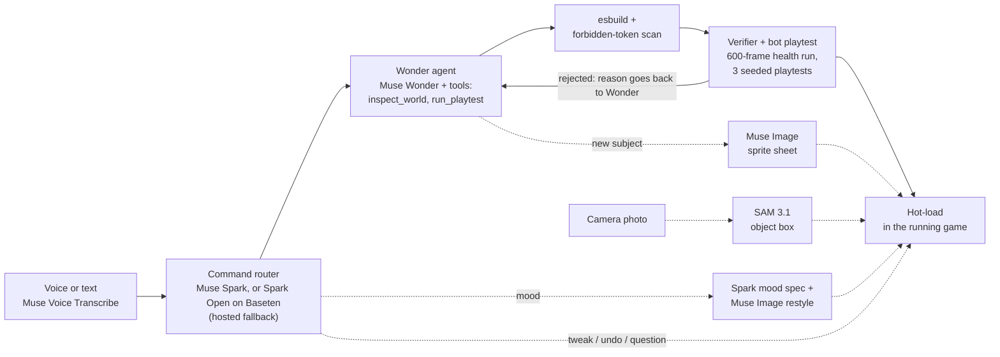

# Architecture

A voice-controlled pixel-art side scroller that builds itself while you play. You say
"make me huge"; AI writes a **mod** against a small engine API, a headless verifier
playtests it, and it hot-loads into the running game. This page is the map. Every claim
points at the file that implements it and the ADR that explains why
([ADR index](adr/README.md)). Run it locally with the steps in the [README](../README.md).

## 1. The pipeline

What happens to one command, in order:

1. **Voice or text.** Hold-to-talk audio goes browser → our server → Muse Voice Transcribe,
   so the API key never reaches the client. A session is kept warm so the key press starts
   transcribing at once. `server/voice.ts`, `src/client/voice.ts`,
   [ADR 0012](adr/0012-voice-hold-to-talk.md).
2. **Router.** One short, structured call decides `new`, `tweak`, `edit`, `undo`, `mood`, `order` or
   `question`, and also picks the thing's visual kind so no second call is needed.
   `server/prompt.ts` (system prompt), `server/index.ts` (`handleSingle`),
   [ADR 0002](adr/0002-router-guardrails.md), [0015](adr/0015-spark-visual-kind-shapes-fx.md).
   Every Meta call uses `reasoning_effort: "minimal"` or replies come back empty
   ([ADR 0001](adr/0001-reasoning-effort-minimal.md), `server/meta.ts`).
   - **Open weights.** When `BASETEN_API_KEY` is set the router runs on Muse Spark Open via
     Baseten's OpenAI-compatible endpoint, and falls back to hosted Spark on error, timeout
     or an empty reply. Unset, nothing changes. The orb names the model that answered.
     `server/router-model.ts`, `scripts/bench-router.ts`,
     [ADR 0032](adr/0032-open-weights-router-on-baseten.md).
   - Compound requests ("add a tree and a slime") are split and built in parallel, at most
     `MAX_PARALLEL` (default 4) at a time. The split call runs alongside the router, so a
     single "and" request does not wait for it. `server/pool.ts`,
     [ADR 0016](adr/0016-parallel-agentic-builds.md), [0058](adr/0058-faster-builds-fewer-sequential-model-turns.md).
   - Relative asks ("make them faster", "jump higher", "more chickens") become instant knob
     tweaks when the target mod has a matching knob, whatever the router answered.
     `server/relative-tweak.ts`, [ADR 0058](adr/0058-faster-builds-fewer-sequential-model-turns.md).
   - **Route rules.** Every deterministic guard on top of Spark's answer (build fallback, mood
     safety net, player ability, pronouns, add-is-a-build, relative tweaks, order checks) is one
     named rule in a pure, ordered pipeline that reports which rules fired.
     `server/route-rules.ts`, [ADR 0059](adr/0059-living-creations-events-speech-orders-and-route-rules.md).
   - **Orders.** "Chickens, follow me", "everyone stay", "dragon, go away" are matched locally
     before the router (no model call) against loaded mods' ids, titles and spawned types; the
     client gives the order and the engine steers those creatures (`src/sim/interact.ts`).
3. **Wonder, as an agent.** Muse Wonder writes the mod through Meta's OpenAI-compatible
   tool calling. Two tools: `inspect_world` (what is loaded: mods, knobs, entity types) and
   `run_playtest` (compile, verify and playtest its own full draft; a pass ends the loop, a
   failure comes back as a reason it can fix). Bounded to 3 tool calls per round, with one
   more fix round if the final source still fails. For edits, player builds and pronoun
   commands the server runs `inspect_world` before the first turn and hands Wonder the
   result as its first call, saving a model turn (ADR 0058). Each call is streamed to the pipeline
   view as a step. `server/agent.ts`, `server/index.ts`,
   [ADR 0013](adr/0013-visible-verifier.md), [0016](adr/0016-parallel-agentic-builds.md),
   [0033](adr/0033-visible-agent-loop-and-autonomy-stats.md).
4. **Compile and safety scan.** Source containing a forbidden token (`eval`, `Function(`,
   `fetch`, `WebSocket`, `document`, `window`, `localStorage`, `process.`, `require(`,
   `import(`) is rejected before esbuild transforms the TypeScript to a module.
   `server/compile.ts`, `FORBIDDEN_MOD_TOKENS` in `src/contract.ts`.
5. **Verifier and bot playtest.** The compiled mod is imported and run for 600 headless
   frames in a fresh world, alone in an empty one ([ADR 0003](adr/0003-verifier-in-process-empty-world.md)).
   It fails on an exception, NaN, entity overflow, a per-frame cost over 2 ms, or a failing
   mod `test()`. Then a scripted bot plays a **copy of the player's current world** with and
   without the mod over three seeds, and the mod is rejected if it makes the game
   unplayable ("you'd be too big to fit through the gap"). `server/verify.ts`,
   `server/playtest.ts`, `src/sim/playtest.ts`. The client can replay the recorded bot
   inputs as a ghost window (`src/client/ghost.ts`).
6. **Hot-load.** The server sends the compiled module; the client loads it from a blob URL
   into the running sim, and its knobs appear as sliders. Undo calls the mod's `dispose()`.
   `src/client/main.ts`, `src/sim/loader.ts`.

**Side paths**
- **Muse Image** draws a sprite sheet the first time a mod introduces a new drawable
  subject; the mod loads at once with a digitizing placeholder and the art streams in.
  Results are cached under `public/art/gen/`. `server/art.ts`,
  [ADR 0007](adr/0007-art-pipeline-chroma-key-first.md), [0008](adr/0008-async-art-digitize-placeholder.md),
  [0009](adr/0009-scenery-vs-creature-art.md).
- **SAM 3.1** finds the object you hold up to the camera (a box, then a client-side cutout
  that becomes a mod). `server/photo.ts`, [ADR 0010](adr/0010-camera-object-prototype.md).
- **Moods.** "Make it spooky" asks Spark for a mood spec (palette, fog, ambient), swaps the
  code-drawn palette and has Muse Image edit each AI sheet from its original.
  `server/mood.ts`, [ADR 0017](adr/0017-world-mood-restyle.md).
- **Draw to build.** A sketch overlay plus Wonder produces a bounded level spec that is
  compiled to a deterministic mod. `server/sketch.ts`, `src/client/sketch.ts`,
  [ADR 0026](adr/0026-draw-to-build-level-sketcher.md).

The same pipeline is visible in the game itself (press **P**): `src/client/pipeline.ts`,
[ADR 0021](adr/0021-in-app-pipeline-view.md), with live impact numbers from
`GET /api/stats` ([ADR 0027](adr/0027-in-app-stats-feed.md), `server/stats-feed.ts`).

**Genre change.** "Turn this into a 2D space shooter" is an ordinary build whose mod calls
`api.setScene({ hideTerrain, hideScenery, backdrop, playerSkin })`. The engine moves terrain
and scenery out of `world.entities` into a claim, the client paints the space backdrop and the
player's generated ship skin from `world.scene`, and unloading the mod (undo) returns
everything exactly. `src/sim/world.ts`, `server/genre.ts`,
[ADR 0066](adr/0066-genre-change-set-scene.md).

**Open-weights path (Baseten, optional).** With `BASETEN_API_KEY` set, Muse Spark Open
routes commands (hosted Spark is the fallback, [ADR 0032](adr/0032-open-weights-router-on-baseten.md)) and
`server/reviewer.ts` reviews each landed build in the background. A fix it proposes is
hot-swapped only if it passes the same compile, 600-frame verify and bot playtest as any
mod, and then feeds the learner (section 4). The review is stamped on the build receipt.
`REVIEWER=off` disables it. [ADR 0068](adr/0068-open-weights-build-reviewer.md).

Hard project rule: every AI call the product makes at runtime goes to a Meta model.

## 2. The deterministic sim and the mod sandbox

The engine holds the laws of nature; everything visible in the game is a mod.

- **Pure, fixed step.** `src/sim/world.ts` steps at 60 Hz (`SIM.dt = 1/60` in
  `src/contract.ts`) with no DOM, no wall clock and no `Math.random`; randomness comes from
  a seeded mulberry32 generator (`src/sim/rng.ts`). The same code runs headless in the
  server's verifier and in the browser, which is what makes a bot playtest a trustworthy
  judge and a ghost replay identical.
- **Budgets.** At most 500 live entities (a spawn at the cap evicts the spawning mod's own oldest
  entity first, then the oldest non-terrain one), a 2 ms per-frame budget for the sim with all mods loaded, 600 health frames
  (`SIM` in `src/contract.ts`). Eviction once deleted the ground, so spawner mods must
  despawn what they make.
- **Mods.** A mod is a module with an `id`, `knobs`, `setup(api)`, `dispose(api)` and a
  `test()`. `ModApi` (`src/contract.ts`) is all it gets: spawn, despawn, damage, queries,
  input, HUD widgets, particles. Everything a mod creates is owned by it and removed on
  `dispose()`, which is why undo is clean. `src/sim/loader.ts` (`ModLoader`), the built-in
  mods in `src/mods/`, [ADR 0019](adr/0019-declarative-mod-hud-api.md) for HUD widgets.
- **Sandbox, honestly.** Isolation is layered, not a VM: the forbidden-token scan, the
  restricted `ModApi`, and a verifier that imports the module in-process from a data URL
  (a worker thread was a stated alternative; see the note in `server/verify.ts`). Model
  output is never trusted to run un-verified: a world only saves mods from the server's own
  verified session manifest, so a share link never runs uploaded code
  (`server/worlds.ts`, [ADR 0014](adr/0014-deploy-share-spend-visitor.md)).
- **Containment.** Every loop in compiled mod JS gets an iteration guard (`guardLoops` in
  `server/compile.ts`), so a runaway loop throws instead of hanging. In the live game a mod
  whose tick handler throws is unloaded and reported, and the frame loop always reschedules
  (`World.onFault`, `ModLoader.isolateFaults`, [ADR 0056](adr/0056-contain-crashing-and-looping-mods.md)).
  The verifier and playtest leave containment off so a crashing mod still fails there.
- **Events, speech, interaction.** `api.on("touch" | "hit" | "death" | "interact" | "order" | "signal")`
  delivers what happened to a mod's entities at the start of the next tick, contained like tick
  handlers; `api.say` puts a speech bubble on `world.speech` (drawn by `src/client/speech.ts`);
  `data.interact` makes an entity usable with the action key; `api.signal` reaches other mods
  ([ADR 0059](adr/0059-living-creations-events-speech-orders-and-route-rules.md)).
- **Broad phase.** Collision queries a uniform grid of solids (`src/sim/grid.ts`) that returns
  candidates in scan order, so results match a full scan
  ([ADR 0057](adr/0057-engine-rules-gear-shots-ground-broad-phase.md)).

## 3. The ontology

`src/ontology.ts` classifies every entity as one of seven kinds: terrain, effect,
projectile, shape, prop, creature, player. It is pure and shared by sim, server and client.
Several decisions hang off the kind instead of scattered word lists: which things may get a
generated sprite sheet (`canUseSpriteSheet`), the art plan (`artPlanFor`: none, held item,
scenery, sheet), whether a request is a whole-world mood (`detectMoodCommand`), and whether a
command is a player ability that must be a new mod rather than an NPC edit. Terrain never
gets a character sprite; a ground is not drawn as a creature.
[ADR 0024](adr/0024-entity-ontology-and-theme-routing.md),
[0031](adr/0031-art-decisions-derive-from-ontology.md),
[0023](adr/0023-reliable-huge-beat.md) (the first user of the player-ability rule).

## 4. The learner

Thumbs up/down and verifier auto-fixes become rules and skills that are fed back into later
prompts. When a fix round turns a rejection into a landed build, or a player rates a mod,
Spark distills a short rule (`server/learned/rules.json`, a readable `RULES.md`) or a
reusable skill (`server/learned/skills/<slug>.md`). `formatLearnedBlock` injects the
relevant ones into the router and Wonder prompts (`server/prompt.ts`). Rules are
deduplicated and capped. `DEMO_FREEZE_LEARNING=1` makes it read-only so a recording day
cannot change what ships. `server/learn.ts`,
[ADR 0020](adr/0020-self-improving-rules.md).

## 5. The spend guard

The game is public and every AI call costs money, so each Meta call is counted *before* it
happens, per visitor (IP) and globally, per UTC day, with a kill switch. Defaults per
session: 20 builds, 24 images, 6 SAM calls, 8 minutes of voice; globally 400, 300, 100 and
120 minutes (`DEFAULT_SESSION` and `DEFAULT_GLOBAL` in `server/budget.ts`; override with the
`BUDGET_*` environment variables, listed in `.env.example`). A refusal is a friendly
sentence in the orb, never an error: the game keeps playing in **visitor mode** with the
curated demo worlds in `worlds/`. Counts persist in `data/budget.json`. Deployment is a
single port serving the built client, art, `/healthz` and the WebSocket
(`server/static.ts`). [ADR 0014](adr/0014-deploy-share-spend-visitor.md).

## Where to look next

| You want | Open |
|---|---|
| Every product decision | [DESIGN.md](DESIGN.md) |
| Meta model capabilities and endpoints | [META-API.md](META-API.md) |
| The demo script and what each beat proves | [DEMO.md](DEMO.md) |
| Measured numbers from the game's own log | [evidence/build-stats.md](evidence/build-stats.md) |
| Wire messages between server and client | `ServerMsg` / `ClientMsg` in `src/contract.ts` |
